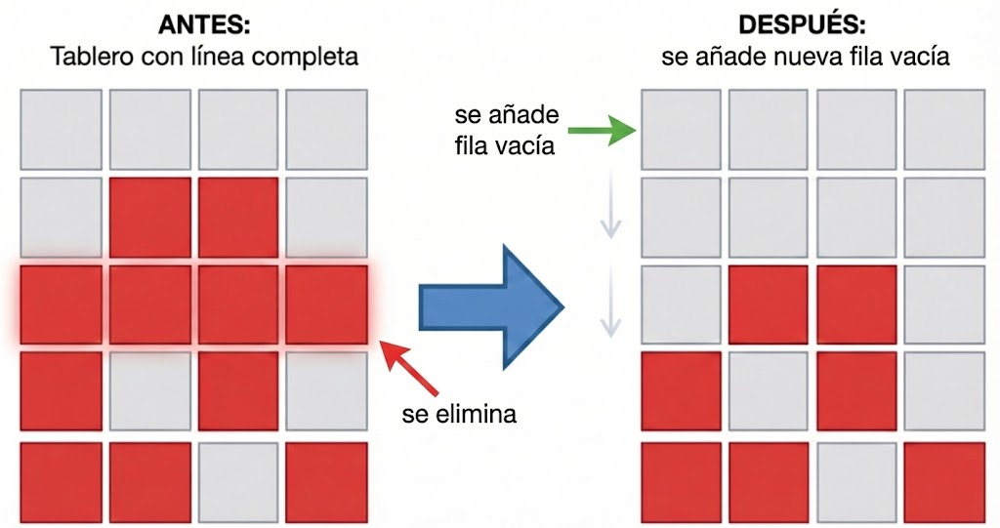

# Examen práctico - Primera Convocatoria 2025-26
## Fundamentos de Programación 1. Grado en Ingeniería Informática – Inteligencia Artificial (Universidad de Sevilla)

## Instrucciones

1. Completa tu **nombre y apellidos** en el fichero `identificacion.txt`.
2. Activa la opción **Autoguardado (Auto Save)** en el menú Archivo (File).
3. Realiza cada ejercicio número X en el módulo `src/ejercicioX.py`. **No toques los prototipos de las funciones ni los comentarios de documentación**.
4. Asegúrate de comprobar que tu implementación pasa todos los tests. Para ejecutar los tests del ejercicio número X, descomenta la línea `#test_ejercicioX()` que encontrarás al final del módulo `src/tests.py`. 
5. Si algún test falla, **utiliza el depurador para tratar de solucionarlo**. 

## Ejercicios

### Ejercicio 1 (1,25 puntos)

Implementa la función `aproxima_numero_e`, que recibe un número entero de **iteraciones** y aproxima el valor del número *e* utilizando la serie de Taylor.

La serie de Taylor para *e* se define como: `e = 1 + 1/1! + 1/2! + 1/3! + ...`

El algoritmo debe sumar tantos términos de la serie como indique el parámetro **iteraciones**. Utiliza un bucle que calcule cada término y acumule la suma de los términos en una variable.

### Ejercicio 2 (1,25 puntos)

Implementa la función `expandir_cadena_incremental`, que recibe una cadena de **texto** y genera una nueva cadena donde cada carácter original se repite tantas veces como indica su posición (índice + 1), siempre que el carácter en cuestión sea distinto del espacio.

Por ejemplo, si **texto** es `"abc d"`, el resultado devuelto será `"abbccc ddddd"`.

### Ejercicio 3 (1,25 puntos)

Implementa la función `obtener_siguiente_lunes`, que dada una **fecha_referencia**, encuentra y devuelve la fecha del próximo lunes.

Debes tener en cuenta que:
* Si la **fecha_referencia** ya es lunes, la función debe devolver el lunes de la semana siguiente (dentro de 7 días).
* En cualquier otro caso, debe buscar el primer lunes posterior a la fecha dada.

### Ejercicio 4 (1,25 puntos)

Implementa la función `inserta_elementos`, que devuelve una nueva lista resultado de insertar los **elementos** indicados en una **lista**.

La función recibe:
* **lista**: La lista original de enteros.
* **elementos**: Una lista de tuplas `(posición, valor)` a insertar.

Ten en cuenta que:
1. La función **no debe modificar** la lista original.
2. Si alguna posición indicada no es válida, ese elemento se ignora y no se inserta. Las posiciones que se consideran válidas son las que van desde 0 hasta el número de elementos. Por ejemplo, si la lista está vacía, la única posición válida es la 0, y si una lista tiene dos elementos las únicas posiciones válidas son la 0, la 1 y la 2.
3. Las posiciones que se indican ser refieren a la lista original. Dado que los índices pueden ir variando a medida que se insertan elementos, **se recomienda insertar los elementos empezando por los de las últimas posiciones (de mayor a menor)**.

Por ejemplo, si la lista es `[10, 20, 30, 40, 50]` y los elementos a insertar son `[(2, 99), (0, 77), (10, 88)]`, el resultado será `[77, 10, 20, 99, 30, 40, 50]`.

### Ejercicio 5 (1 punto)

Implementa la función `comprueba_tablero_correcto`, que recibe una matriz (**tablero**) que representa un juego de Tetris y verifica si es válida. 

El **tablero** es una lista de filas, donde cada fila es a su vez una lista de `bool` (representando `True` una celda ocupada y `False` vacía). Para que el tablero sea correcto debe cumplirse:
1. Que tenga al menos 5 filas.
2. Que todas las filas tengan la misma longitud.
3. Que todas las celdas contengan únicamente valores `True` o `False`.

La función debe devolver `True` si el tablero es correcto y `False` en caso contrario.

### Ejercicio 6 (1,25 puntos)

Implementa la función `limpiar_lineas_tetris`, que analiza un **tablero** de Tetris, eliminando las líneas que están completas y añadiendo nuevas líneas vacías en la parte superior para mantener el tamaño del tablero.



El funcionamiento es el siguiente:
* Se recorre el tablero de abajo hacia arriba, es decir, desde la última fila hasta la primera.
* Si una fila está completa (todos sus valores son `True`), esa fila se elimina del tablero.
* Por cada fila eliminada, se inserta una nueva fila llena de `False` al principio del tablero.

La función debe devolver un entero indicando el **número de líneas completas eliminadas**.

Supondremos en todo momento que el tablero recibido es correcto (según lo explicado en el ejercicio 5).

---
---
### Tupla nombrada `Articulo`

En los siguientes ejercicios se utilizará la siguiente `namedtuple`, que representa un artículo de alimentación:

```python
Articulo = namedtuple('Articulo', [
    'nombre',       # tipo str
    'categoria',    # tipo str
    'precio',       # tipo float
    'fecha_caducidad'  # tipo date
])
```

Cada tupla de tipo `Articulo` representa una unidad de dicho artículo, de manera que en las listas con las que trabajaremos pueden aparecer varios artículos iguales, con el mismo nombre, categoría y precio (aunque podrían tener distinta fecha de caducidad).

### Ejercicio 7 (1,25 puntos)

Implementa la función `categoria_precio_medio_menor`, que dada una lista de **articulos**, devuelve el nombre de la categoría que tiene la media de precios más baja.

Detalles importantes:
1. Aunque en la lista de entrada haya artículos repetidos, para calcular la media solo se deben tener en cuenta los **artículos únicos** (aquellos con distinto nombre, categoría y precio).
2. Si la lista de artículos está vacía, debe devolverse una cadena vacía `""`.

### Ejercicio 8 (1,5 puntos)

Implementa la función `vende_articulos`, que gestiona la venta de una lista de artículos hasta alcanzar un objetivo de ganancia.

La función recibe:
* **articulos**: Lista de tuplas `Articulo` disponibles.
* **objetivo_ganancia**: número real con la cantidad de dinero que se desea conseguir con la venta.
* **descuentos**: Diccionario donde la clave es la categoría y el valor es el porcentaje de descuento a aplicar.

La lógica de venta es la siguiente:
1. Los artículos se intentan vender ordenados por su **fecha de caducidad** (los más próximos a caducar se venderán primero).
2. Si un artículo ya ha caducado (su fecha es anterior a hoy), **no se vende y se se retira** de la lista de disponibles.
3. Si el artículo es vendible, se calcula su precio final, aplicando el descuento de su categoría si existe en el diccionario (si no, se mantiene el precio sin variación).
4. El proceso se detiene cuando se alcanza o supera el **objetivo_ganancia** o se acaban los artículos.
5. Los artículos vendidos y los que han caducado se retiran de la lista original recibida como parámetro (**la lista recibida se modifica**).

La función debe devolver una tupla: `(lista_articulos_vendidos, ganancia_total_obtenida)`.